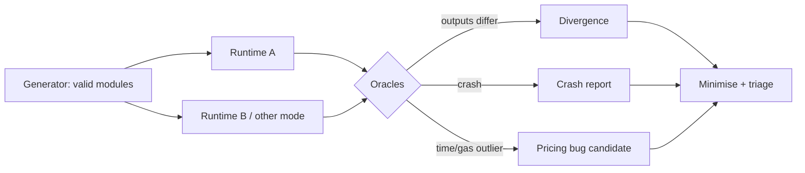

# Why Fuzz Virtual Machines

Blockchains run user code inside virtual machines: the EVM, WebAssembly runtimes (CosmWasm, Polkadot/Substrate, NEAR, Stellar Soroban, and others), the Move VM (Sui, Aptos), the SVM (Solana) and Cairo VM (Starknet). A VM bug can:

- break **consensus** if nodes disagree on execution results (chain split);
- enable **sandbox escape** into the node process;
- break **gas metering** (unbounded work for bounded fees → DoS);
- violate language guarantees (e.g. Move's resource safety) that contracts rely on.

Outside blockchains, Wasm runtimes power browsers, edge computing and plugin systems, so the same techniques apply.

A VM is an unusually good fuzzing target. Its input language is precisely specified, so generators can produce valid programs by construction. It has several independent implementations, so outputs can be compared. And its correctness requirements are strict and checkable: the same module with the same inputs must always produce the same result, trap or gas count. That last property is what turns many "harmless" differences into critical bugs on a blockchain.

## Targets in this book

| VM | Implementations (examples) | Key properties to test |
|---|---|---|
| Wasm | Wasmtime, Wasmer, wasmi, V8, SpiderMonkey | spec conformance, JIT correctness, memory safety, determinism |
| Move | Sui and Aptos Move VMs, bytecode verifier | verifier soundness, resource safety, gas |
| Cairo | Cairo VM implementations | field arithmetic, hints |

The Wasm runtimes differ in architecture, which matters for where bugs hide. Wasmtime compiles ahead of execution with Cranelift (and has a baseline compiler, Winch). wasmi is an interpreter written for embedded and blockchain use, where predictable behaviour matters more than speed. Browser engines tier between interpreters and optimising JITs. Each architecture brings its own bug classes: miscompilation in JITs, stack handling in interpreters, and tier-transition bugs in engines that switch between the two.

## Bug oracles

1. **Crashes and sanitizers** (memory safety).
2. **Differential:** two implementations or two modes (interpreter vs JIT) disagree.
3. **Verifier soundness:** bytecode accepted by the verifier violates safety at runtime.
4. **Gas invariants:** execution time per gas unit stays within bounds.

An oracle is what turns an execution into a verdict. Without one, a fuzzer only finds crashes. With a differential oracle it finds silent miscompilations, which are the bugs that split chains. The table below summarises what each oracle needs.

| Oracle | Needs | Finds | False positives from |
|---|---|---|---|
| Crash / sanitizer | ASan or debug assertions build | memory corruption, panics | intentional aborts on resource limits |
| Differential | two implementations or modes | miscompilation, spec deviations | legitimate non-determinism (NaN bits, limits) |
| Verifier soundness | runtime checks or reference semantics | unsafe bytecode accepted | missing runtime checks in the reference |
| Gas invariant | stable timing environment | underpriced operations | timing noise |



## Worked example

> **Execution status:** not executed in this book's CI; verify locally. Outputs below are expected results, not observed ones.

Compile a small Rust function to Wasm and run it on two engines: Wasmtime (CLI) and V8 (through Node.js's built-in `WebAssembly` API). This is the smallest possible differential test.

```rust
// src/lib.rs   (crate-type = ["cdylib"] in Cargo.toml)
#[no_mangle]
pub extern "C" fn mix(a: i32, b: i32) -> i32 {
    a.wrapping_mul(31).rotate_left(5) ^ b.wrapping_sub(7)
}
```

```bash
rustup target add wasm32-unknown-unknown
cargo build --release --target wasm32-unknown-unknown
W=target/wasm32-unknown-unknown/release/mix_demo.wasm   # name follows your crate
wasmtime run --invoke mix $W 123456 -42
node -e '
const fs=require("fs");
WebAssembly.instantiate(fs.readFileSync(process.argv[1])).then(({instance})=>
  console.log(instance.exports.mix(123456,-42)));' $W
```

Both commands should print the same integer. Now write a loop that calls both with a few thousand random argument pairs and compares outputs; any mismatch is a finding to minimise. Then try a float function (`f32::sqrt` of a negative number) and compare the NaN bit patterns with `f32::to_bits`. The Wasm spec allows NaN payloads to differ, which is why blockchain runtimes either forbid floats or canonicalise NaNs. That is exercise 3 below in miniature.

The checker in this example is plain string comparison of outputs, which is exactly the property consensus needs.

## Common pitfalls

- **Fuzzing default configurations.** A chain's runtime has specific features, limits and metering; test those.
- **Crash-only oracles.** Miscompilations do not crash; they return a different answer.
- **Treating every difference as a bug.** Some are allowed by the spec (NaN payloads, resource limits); know which before reporting.
- **Ignoring the host functions.** Chain-specific host calls (storage, crypto) are often less fuzzed than the core VM.
- **Testing against mainnet nodes.** Run everything locally; never send fuzzed transactions to live networks.

## Exercises

1. Pick a Wasm runtime and list which of the four oracles its existing fuzzers use (check its fuzz directory).
2. Compile a small Rust function to Wasm and run it on two runtimes; compare outputs.
3. Explain why nondeterministic floats are a consensus risk and how blockchain Wasm runtimes handle them.

## Further reading

- Wasmtime fuzzing docs: <https://docs.wasmtime.dev/contributing-fuzzing.html>
- WebAssembly spec: <https://webassembly.github.io/spec/>
- Move book: <https://move-book.com>
- wasmi: <https://github.com/wasmi-labs/wasmi>
