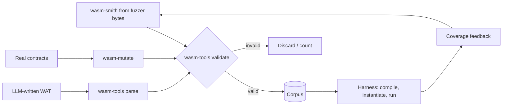

# Generating Valid Wasm Modules

Random bytes are almost never valid Wasm. Effective fuzzers generate **valid modules** by construction.

The Wasm validator checks types on an operand stack, control-flow nesting, index bounds for functions, locals, globals, tables and memories, and much more. A random byte string fails one of those checks within a few bytes. A byte-level fuzzer such as AFL can eventually learn the header, but it spends almost all its time in the parser's rejection paths. To reach the compiler and the runtime, the fuzzer must produce modules that validate.

## wasm-smith

`wasm-smith` (in the Bytecode Alliance `wasm-tools`) generates valid Wasm modules from fuzzer-provided bytes, with configurable features (SIMD, reference types, multi-memory, GC proposals). It is used by Wasmtime's own fuzzing in OSS-Fuzz.

```rust
#![no_main]
use libfuzzer_sys::fuzz_target;
use wasm_smith::Module;

fuzz_target!(|m: Module| {
    let bytes = m.to_bytes();
    // feed bytes to the runtime under test: validate, compile, instantiate, run exports
});
```

The trick is that wasm-smith interprets the fuzzer's bytes as a sequence of **choices** (through the `arbitrary` crate): how many functions, which instruction next, which type. Coverage-guided mutation of those bytes therefore becomes mutation of program structure. Small byte changes produce small program changes, which is what coverage guidance needs.

## Configuration matters

- Enable features the target supports; disable those it does not, otherwise you only test rejection paths.
- Bound resources (memory pages, table sizes, instruction counts) to keep executions fast.
- Ensure termination: inject fuel/step limits.

wasm-smith exposes these through its `Config` struct (feature toggles such as SIMD and reference types, NaN canonicalisation, maximum counts of functions, memories and instructions). Field names change between versions, so check the docs for the version you pin. For a blockchain target, write down the chain's enabled feature set first and mirror it exactly.

| Setting | Why |
|---|---|
| Disable unsupported proposals | otherwise most modules are rejected at validation |
| Canonicalise NaNs (if floats allowed) | removes allowed non-determinism before differential comparison |
| Cap instructions per function | keeps executions short, raises execs/sec |
| Disallow start functions with traps, or handle them | avoids instantiation noise |

## Mutating real-world modules

Complement generation with mutation of real contracts (e.g. CosmWasm contracts, Substrate runtime modules). `wasm-mutate` performs semantics-preserving or semantics-changing mutations, useful for differential testing (equivalent modules must behave identically).

Real modules exercise patterns generators rarely produce: large data segments, compiler-specific idioms, long functions from optimised Rust or C. Use them as seeds; generated modules explore the corners.

## LLM-assisted generation

Models can write WAT (text format) programs targeting specific features ("use `memory.grow` inside a loop with `br_table`"). Validate with `wasm-tools validate`. Use these as seeds for the generators.

The validator is the checker. Expect a meaningful share of model-written WAT to fail validation (wrong stack types, missing `end`), and simply discard those. Valid ones are added to the corpus and kept only if coverage tooling shows they reach code the existing corpus did not. Models are most useful for new proposals, where existing corpora are thin.



## Worked example

> **Execution status:** not executed in this book's CI; verify locally. Outputs below are expected results, not observed ones.

Use the `wasm-tools` CLI to see generation, validation and mutation without writing a harness.

```bash
cargo install wasm-tools
# 1. generate a module from random bytes, then inspect it
head -c 4096 /dev/urandom | wasm-tools smith -o gen.wasm
wasm-tools validate gen.wasm && echo valid
wasm-tools print gen.wasm | head -30
# 2. validate a hand- or model-written WAT seed
cat > seed.wat <<'EOF'
(module
  (memory 1 4)
  (func (export "grow_loop") (param $n i32) (result i32)
    (local $i i32)
    (block $done
      (loop $l
        (br_if $done (i32.ge_u (local.get $i) (local.get $n)))
        (drop (memory.grow (i32.const 1)))
        (local.set $i (i32.add (local.get $i) (i32.const 1)))
        (br $l)))
    (memory.size)))
EOF
wasm-tools parse seed.wat -o seed.wasm && wasm-tools validate seed.wasm && echo valid
# 3. mutate it
for s in 1 2 3; do wasm-tools mutate seed.wasm --seed $s -o mut$s.wasm; done
for f in mut*.wasm; do wasm-tools validate "$f" && echo "$f valid"; done
```

Expected: `valid` for the generated module and the seed, and valid mutants. Invoking `grow_loop` with 10 in Wasmtime should return 4: memory starts at 1 page and the maximum is 4, so later `memory.grow` calls fail (return -1) and the size stays at 4.

Then set up a fuzz target: `cargo fuzz init`, add `wasm-smith` and the runtime under test (start with `wasmi`) as dependencies, and use the `fuzz_target!` above to validate, instantiate and call every exported function with zero arguments. Run `cargo fuzz run <target> -- -max_total_time=3600` and record execs/sec and coverage.

## Common pitfalls

- **Generator features out of sync with the target.** Rejected modules look like activity but test nothing.
- **No termination bound.** One infinite loop stalls a fuzzing worker; use fuel or epoch interruption.
- **Seeds that never validate.** Check model output with the validator before adding it.
- **Ignoring instantiation.** Many bugs are in data/element segment initialisation and start functions, not in calls.
- **Measuring success by corpus size.** Coverage and unique behaviours matter, not file count.

## Exercises

1. Set up a cargo-fuzz target with wasm-smith against wasmi and run it for an hour.
2. Use wasm-mutate to create equivalent variants and check results match.
3. Ask a model for 20 WAT programs exercising edge cases, validate them, and add the valid ones as seeds.

## Further reading

- wasm-tools (wasm-smith, wasm-mutate): <https://github.com/bytecodealliance/wasm-tools>
- cargo-fuzz: <https://github.com/rust-fuzz/cargo-fuzz>
- Wasmtime fuzz targets: <https://github.com/bytecodealliance/wasmtime/tree/main/fuzz>
- wasm-smith API docs: <https://docs.rs/wasm-smith>
