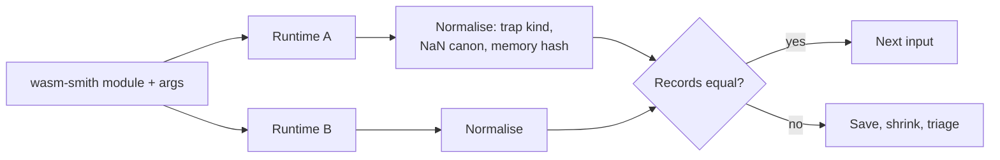

# Differential Runtime Testing

Differential testing runs the same input on two implementations and compares results. For VMs it is the most productive oracle after crashes, because the most dangerous bugs (miscompilations, spec deviations, metering mismatches) produce wrong answers rather than crashes. On a blockchain, a wrong answer on some nodes is a consensus failure.

## Pairs to compare

- Interpreter vs JIT in the same runtime (e.g. Cranelift-compiled vs interpreted).
- Different runtimes (Wasmtime vs wasmi vs V8).
- Optimisation levels.
- Old vs new version (regression detection).
- Reference interpreter (spec interpreter) vs production runtime.

Each pair finds different bugs. Two modes of one runtime share a front end (parser, validator), so they only find back-end bugs. Two independent runtimes find front-end bugs too, but disagree more often on legitimately unspecified behaviour. Old-versus-new is the cheapest and most relevant for blockchains, because a node upgrade that changes results is exactly what causes a split during a rolling upgrade.

## What to compare

- Return values of exported functions.
- Traps (kind and location).
- Final linear memory and globals (hash).
- Gas/fuel consumed (for blockchain runtimes with deterministic metering).

Represent each execution as a canonical record and compare records, not log text:

```
Outcome = Return(values) | Trap(kind) | ResourceExhausted
Record  = { outcome, memory_hash, globals, fuel_used? }
```

## Normalisation

- NaN bit patterns can legitimately differ in standard Wasm unless canonicalised; blockchain runtimes typically disable or canonicalise floats. Normalise or restrict.
- Stack overflow limits differ; treat "both trapped with resource exhaustion" as equal.
- Trap messages differ between runtimes; map them onto a small set of kinds (unreachable, out-of-bounds memory, integer divide by zero, integer overflow, indirect call type mismatch, stack exhaustion).

Normalisation is where differential harnesses go wrong in both directions. Too little, and the fuzzer drowns in false positives. Too much, and real bugs get normalised away. A good rule is to normalise only differences the spec explicitly permits, and to list each rule with a spec reference in the harness source.



## Blockchain angle

In blockchains, any disagreement between nodes is a potential chain split. Even trap location or gas differences matter. Fuzz the exact runtime configuration used in consensus (features, limits, metering) rather than default settings.

There is a second blockchain-specific pair: **the same runtime on different hardware**. A JIT that emits different code on x86-64 and AArch64 can disagree with itself across validators. If the chain's validator set is mixed, run the differential harness on both architectures.

## Worked example

> **Execution status:** not executed in this book's CI; verify locally. Outputs below are expected results, not observed ones. The wasmi API shown matches the 0.3x series; newer releases renamed some calls (check docs.rs for your pinned version).

A two-runtime harness comparing Wasmtime and wasmi on a single exported function `f: (i32, i32) -> i32`. Extend it to wasm-smith inputs once it works.

```rust
// Cargo.toml: wasmtime = "<pinned>", wasmi = "0.31", anyhow = "1"
use anyhow::Result;

#[derive(Debug, PartialEq)]
enum Outcome { Ret(i32), Trap(String) }

fn kind(msg: &str) -> String {
    let m = msg.to_lowercase();
    for k in ["unreachable", "out of bounds", "divide by zero", "overflow", "stack"] {
        if m.contains(k) { return k.into(); }
    }
    "other".into()
}

fn run_wasmtime(bytes: &[u8], a: i32, b: i32) -> Result<Outcome> {
    let engine = wasmtime::Engine::default();
    let module = wasmtime::Module::new(&engine, bytes)?;
    let mut store = wasmtime::Store::new(&engine, ());
    let inst = wasmtime::Instance::new(&mut store, &module, &[])?;
    let f = inst.get_typed_func::<(i32, i32), i32>(&mut store, "f")?;
    Ok(match f.call(&mut store, (a, b)) {
        Ok(v) => Outcome::Ret(v),
        Err(e) => Outcome::Trap(kind(&format!("{e:?}"))),
    })
}

fn run_wasmi(bytes: &[u8], a: i32, b: i32) -> Result<Outcome> {
    let engine = wasmi::Engine::default();
    let module = wasmi::Module::new(&engine, bytes)?;
    let mut store = wasmi::Store::new(&engine, ());
    let linker = wasmi::Linker::<()>::new(&engine);
    let inst = linker.instantiate(&mut store, &module)?.start(&mut store)?;
    let f = inst.get_typed_func::<(i32, i32), i32>(&store, "f")?;
    Ok(match f.call(&mut store, (a, b)) {
        Ok(v) => Outcome::Ret(v),
        Err(e) => Outcome::Trap(kind(&format!("{e:?}"))),
    })
}

fn main() -> Result<()> {
    let wat = r#"(module (func (export "f") (param i32 i32) (result i32)
                   (i32.div_s (local.get 0) (local.get 1))))"#;
    let bytes = wat::parse_str(wat)?;   // add wat = "1"
    for (a, b) in [(7, 2), (1, 0), (i32::MIN, -1)] {
        let (x, y) = (run_wasmtime(&bytes, a, b)?, run_wasmi(&bytes, a, b)?);
        println!("{a} / {b}: wasmtime={x:?} wasmi={y:?} {}", if x == y { "OK" } else { "DIVERGE" });
    }
    Ok(())
}
```

Expected output: `Ret(3)` from both for `7 / 2`; a divide-by-zero trap from both for `1 / 0`; and an overflow trap from both for `i32::MIN / -1`, all marked `OK`. These three inputs are chosen because they are the classic edge cases of signed division. If the trap-kind mapping is too coarse (for example both map to `other`), you will see `OK` for the wrong reason; print raw messages once to tune `kind()`.

Next, replace the fixed WAT with `wasm_smith::Module`, call every export whose signature you can supply with arguments, compare `Outcome` plus a SHA-256 of exported memory, and save any `DIVERGE` input for shrinking (Chapter 6).

## Common pitfalls

- **Comparing error strings.** Map traps to kinds; message text differs between runtimes and versions.
- **Normalising away real bugs.** Each normalisation rule should cite the spec clause that allows the difference.
- **Different configurations on each side.** Features, stack limits and fuel settings must match, or divergences are configuration noise.
- **Single-architecture testing.** Validators run on mixed hardware; JIT bugs can be architecture-specific.
- **Not saving the exact input.** A divergence you cannot replay is not a finding.

## Exercises

1. Build a differential harness comparing wasmi and Wasmtime on wasm-smith modules with floats disabled.
2. Add memory hashing and gas comparison.
3. Reproduce a known historical differential bug from a runtime's issue tracker.

## Further reading

- Wasmtime differential fuzzing: <https://docs.wasmtime.dev/contributing-fuzzing.html>
- Perényi & Midtgaard, "Stack-Driven Program Generation of WebAssembly", APLAS 2020
- Wasmtime API docs: <https://docs.rs/wasmtime>
- wasmi API docs: <https://docs.rs/wasmi>
