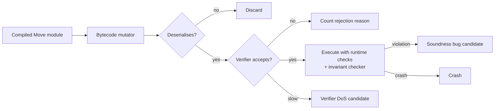

# Fuzzing the Move VM and Bytecode Verifier

Move's safety (resources cannot be copied or dropped unless allowed; references are safe; types are respected) is enforced by the **bytecode verifier** before execution. If the verifier accepts unsafe bytecode, contracts that rely on Move's guarantees can be broken.

This design is different from the EVM. In Solidity, safety comes from the compiler and from checks the contract author writes. In Move, anyone can publish raw bytecode, not just compiler output, so the compiler's checks are irrelevant to an attacker. The verifier is the only gate. A token implemented as a Move struct without the `copy` ability is safe from duplication only because the verifier rejects any bytecode that copies it.

## What the verifier checks

| Check | Guarantees | Bug impact if wrong |
|---|---|---|
| Bounds and structure | indices in range, well-formed tables | VM crash or out-of-bounds read |
| Type safety | stack and locals typed correctly | type confusion between structs |
| Abilities (`copy`, `drop`, `store`, `key`) | resources not duplicated or discarded | minting assets from nothing |
| Reference safety (borrow checking) | no dangling or aliased mutable references | memory-safety-like violations inside the VM |
| Locals safety | no use of moved or unavailable values | duplicated values |
| Instantiation loops, limits | generic instantiation bounded | verifier or VM DoS |

Sui adds its own passes on top (for example, object and ID rules), so "the Move verifier" means a different set of checks on each chain.

## Oracles

1. **Verifier soundness:** generate bytecode, run the verifier; if accepted, execute with runtime checks (or a reference semantics) and look for violations (duplicated resources, dangling references, type confusion).
2. **Crash safety:** verifier and VM must not crash on any input (a crash in the verifier is a DoS on validators processing published modules).
3. **Differential:** Sui and Aptos share Move heritage but have diverged; compare behaviour of shared subsets carefully (expect intended differences).
4. **Gas metering:** verifier complexity and execution must be bounded by gas or limits; pathological modules that take very long to verify are DoS vectors.

The soundness oracle needs care. The VM has some runtime checks (the "paranoid" type checks some implementations can enable), and a soundness bug shows up as a runtime invariant failure on bytecode the verifier accepted. Where no runtime check exists, write a small invariant checker: for example, count values of a non-`copy` type before and after execution of a transaction and require that the count changes only through pack and unpack.



## Generation

- Mutate compiled modules (instruction-level mutations: swap instructions, change type indices, adjust locals).
- Generate from Move source with a grammar, compile, then mutate bytecode.
- Use the existing fuzz targets in the Move/Sui/Aptos repositories as starting points.

Mutations should operate on the deserialised module structure, not raw bytes. The `move-binary-format` crate (vendored in both Sui and Aptos repositories) provides the in-memory `CompiledModule` representation with serialisation and deserialisation. Mutating a parsed module and re-serialising keeps most inputs well-formed, so they reach the verifier's semantic passes rather than the deserialiser.

LLMs can help here in a narrow way: proposing mutations aimed at a specific pass ("make a function that borrows a field mutably twice through different paths"). The verifier is the checker; the model's description of what its mutation "should" do is irrelevant.

## Historic note

Move-based chains have run bug bounties with significant payouts, and several reported verifier issues have involved resource-safety and DoS. Read published advisories in the respective repositories' security sections.

## Worked example

> **Execution status:** not executed in this book's CI; verify locally. Outputs below are expected results, not observed ones.

Start from the human-visible end: show that the Move compiler rejects a resource duplication, then move to bytecode, where the verifier must do the same job alone. Uses the Sui CLI.

```bash
sui move new dupdemo && cd dupdemo
cat > sources/gold.move <<'EOF'
module dupdemo::gold {
    public struct Gold has store { value: u64 }      // no `copy`, no `drop`
    public fun mint(value: u64): Gold { Gold { value } }
    public fun dup(g: &Gold): (Gold, Gold) { (*g, *g) }   // attempted duplication
}
EOF
sui move build
```

Expected: the build fails with an error that dereferencing requires the `copy` ability, which `Gold` lacks. That is the compiler protecting honest developers.

Now remove `dup`, build successfully, and find the compiled module under `build/dupdemo/bytecode_modules/gold.mv`. The bytecode-level experiment is to write a small Rust tool that:

1. deserialises `gold.mv` with `move-binary-format`;
2. adds a function whose body is `MoveLoc(0); ReadRef; ...` equivalent to the rejected `dup` (or mutates an existing body into it);
3. re-serialises and runs the chain's bytecode verifier entry point on the result.

Expected: the verifier rejects the module with an ability-related error. Record the error code. Then turn the tool into a mutator: apply random instruction swaps and type-index changes to many functions, and log (a) verifier crashes, (b) verification time per module, and (c) any module accepted that your invariant checker flags at runtime. Run everything locally; never publish mutated modules to a public network, including testnets you do not control.

## Common pitfalls

- **Testing only via source.** Attackers publish bytecode; the compiler is not a security boundary.
- **Byte-level mutation only.** Most inputs die in deserialisation; mutate the parsed structure.
- **Assuming Sui and Aptos verifiers are the same.** They have diverged; differences may be intended.
- **No timing oracle.** Verifier slowness on crafted modules is a validator DoS, even without a soundness issue.
- **Disclosing publicly.** Verifier bugs are critical; report privately to the chain's security team or bug bounty programme.

## Exercises

1. Build a bytecode mutator for Move modules and run the verifier for an hour, logging crashes and slow cases.
2. Measure verifier time vs module size and find super-linear cases.
3. Write a module that attempts to duplicate a resource and confirm the verifier rejects it.

## Further reading

- Move language and verifier: <https://github.com/move-language/move> (archived; see Sui and Aptos forks)
- Sui repository: <https://github.com/MystenLabs/sui>
- Aptos core: <https://github.com/aptos-labs/aptos-core>
- Move Prover: <https://aptos.dev/en/build/smart-contracts/prover>
- Blackshear et al., "Move: A Language With Programmable Resources" (Libra/Diem white paper, 2019)
