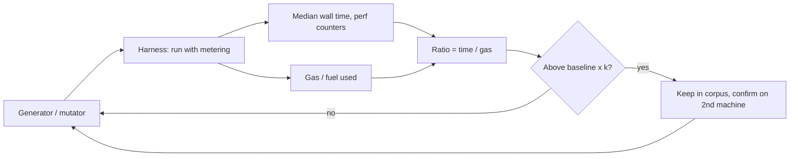

# Gas Metering Bugs

Gas makes computation cost money. If some operation is underpriced relative to its real cost, attackers can submit cheap transactions that consume excessive validator resources.

The effect is a denial of service with an economic twist. An attacker who finds an operation that costs ten times more validator time per unit of gas than average can fill blocks with it and slow every node down for the price of an ordinary block. Validators fall behind, block times stretch, and in the worst case nodes on weaker hardware drop out. The bug is not a crash, so crash-oriented fuzzing never finds it.

## Classes

| Class | Example |
|---|---|
| Underpriced instruction | an opcode that does O(n) work charged as O(1) |
| Unmetered host function | host call (crypto, storage) not charged or charged flatly |
| Verification/compilation cost | module publishing triggers expensive verification or JIT compilation, not charged |
| Memory growth | allocations charged too little |
| Caching asymmetries | worst-case cache misses charged at cached prices |

Ethereum itself has repriced opcodes repeatedly in response to DoS attacks (e.g. the 2016 "Shanghai attacks" leading to EIP-150 repricing).

Wasm runtimes have a structural version of the first class. Generic instruction-counting meters, such as Wasmtime's fuel, charge roughly per instruction. Bulk-memory instructions (`memory.fill`, `memory.copy`) and `memory.grow` are single instructions whose work scales with an operand. A chain that meters with plain instruction counts must add per-byte charges for those, and must be tested to confirm it does.

## Finding them by fuzzing

Use a fuzzer whose **objective is time per gas**:

```
fitness(input) = wall_time(input) / gas_used(input)
keep inputs that maximise fitness; report outliers above a threshold
```

This is a performance-fuzzing setup (similar to PerfFuzz). Run on dedicated hardware with stable timing; repeat measurements to reduce noise.

Timing is noisy, so build the measurement carefully:

- pin the process to one core and disable frequency scaling where you can;
- run each candidate several times and use the median;
- report the ratio against a baseline of ordinary instructions measured the same way;
- confirm outliers on a second machine before believing them.

An alternative to wall time is a hardware-independent cost proxy, such as instructions retired from `perf stat`. It is less noisy but can miss memory-bound costs such as cache misses, which are exactly what some pricing bugs exploit. Use both.



## Worked example

> **Execution status:** not executed in this book's CI; verify locally. Outputs below are expected results, not observed ones. Wasmtime's fuel API has changed across versions (`set_fuel`/`get_fuel` in recent releases); check docs.rs for your pinned version.

Compare nanoseconds per fuel unit for an arithmetic loop and for `memory.fill` in Wasmtime with fuel enabled.

```rust
use std::time::Instant;
use wasmtime::{Config, Engine, Instance, Module, Store};

const WAT: &str = r#"(module
  (memory 16)
  (func (export "adds") (param $n i32) (local $i i32) (local $acc i32)
    (loop $l
      (local.set $acc (i32.add (local.get $acc) (local.get $i)))
      (local.set $i (i32.add (local.get $i) (i32.const 1)))
      (br_if $l (i32.lt_u (local.get $i) (local.get $n)))))
  (func (export "fills") (param $n i32) (local $i i32)
    (loop $l
      (memory.fill (i32.const 0) (i32.const 7) (i32.const 1048576))
      (local.set $i (i32.add (local.get $i) (i32.const 1)))
      (br_if $l (i32.lt_u (local.get $i) (local.get $n))))))"#;

fn measure(name: &str, n: i32) -> anyhow::Result<()> {
    let mut cfg = Config::new();
    cfg.consume_fuel(true);
    let engine = Engine::new(&cfg)?;
    let module = Module::new(&engine, WAT)?;          // requires the `wat` feature (default)
    let mut store = Store::new(&engine, ());
    store.set_fuel(u64::MAX / 2)?;
    let inst = Instance::new(&mut store, &module, &[])?;
    let f = inst.get_typed_func::<i32, ()>(&mut store, name)?;
    let before = store.get_fuel()?;
    let t = Instant::now();
    f.call(&mut store, n)?;
    let ns = t.elapsed().as_nanos() as f64;
    let used = (before - store.get_fuel()?) as f64;
    println!("{name:6} fuel={used:>12} ns/fuel={:.3}", ns / used);
    Ok(())
}

fn main() -> anyhow::Result<()> {
    measure("adds", 10_000_000)?;
    measure("fills", 1_000)?;
    Ok(())
}
```

Expected: `adds` consumes tens of millions of fuel at a small fraction of a nanosecond per unit. `fills` consumes only a few thousand fuel units (each 1 MiB fill counts as roughly one instruction) yet takes a comparable or longer time, so its ns/fuel is orders of magnitude higher. That ratio is the finding pattern. For Wasmtime itself this is documented behaviour: fuel is a coarse instruction budget, not a price list. For a blockchain that uses instruction counting as gas, the same measurement is a pricing bug unless the chain charges per byte for bulk memory.

Turn it into a fuzzer by generating modules with wasm-smith, running each under the same measurement with repeats, and keeping those with the highest median ratio.

## Common pitfalls

- **Single timing samples.** Use medians over repeats and confirm on a second machine.
- **Ignoring publish-time costs.** Verification and compilation can be the most expensive part and are often charged flatly.
- **Benchmarking on a laptop on battery.** Frequency scaling dominates the signal.
- **Forgetting host functions.** Cryptographic and storage host calls are common sources of mispricing.
- **Reporting documented behaviour as a bug.** Check whether the runtime claims its meter is a cost model before filing upstream; the bug may belong to the chain's configuration.

## Exercises

1. Implement time-per-gas fitness in a LibAFL or cargo-fuzz harness for a Wasm runtime with fuel metering.
2. Find the most expensive instruction per fuel unit on that runtime.
3. Read EIP-150 and summarise the attacks that motivated it.

## Further reading

- Lemieux et al., "PerfFuzz: Automatically Generating Pathological Inputs", ISSTA 2018
- EIP-150: <https://eips.ethereum.org/EIPS/eip-150>
- Wasmtime fuel docs: <https://docs.wasmtime.dev>
- Wasmtime `Store` API (fuel): <https://docs.rs/wasmtime>
