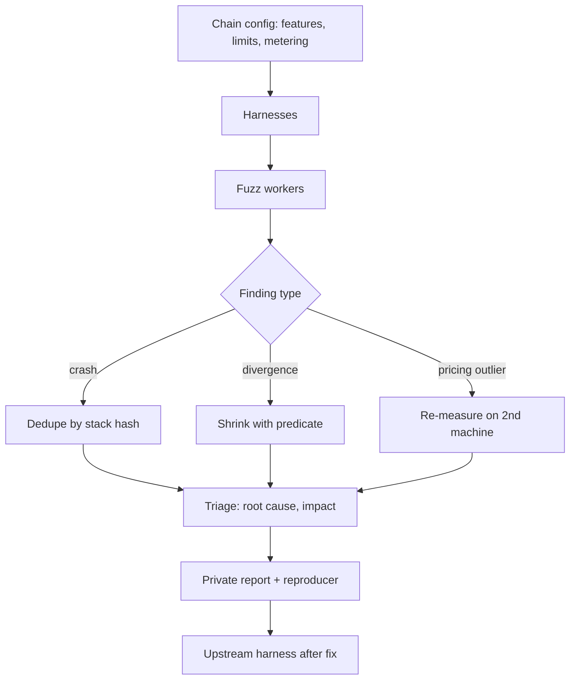

# Running a VM Fuzzing Campaign

The earlier chapters described generators, oracles and harnesses. A campaign puts them together for a fixed target, a fixed time and a measurable outcome. Most of the work in a successful campaign is not in the fuzzer at all: it is in choosing the configuration, keeping the infrastructure running, triaging results quickly and disclosing responsibly.

## Plan

1. **Pick configuration:** the exact consensus configuration of the target chain (features, limits, metering).
2. **Harnesses:** generation (wasm-smith/Move generators), mutation (real modules), differential pairs, gas fitness.
3. **Infrastructure:** many cores, long runs; consider distributing (see **decentralized-security-compute**).
4. **Triage:** dedupe crashes by stack; for differential bugs, minimise the module (`wasm-tools shrink`) and identify the first diverging instruction.
5. **Disclosure:** VM bugs in blockchains are critical; report privately to the chain's security team and bug bounty programme.



## Metrics

- Coverage of the runtime's interpreter/compiler.
- Executions per second per core.
- Unique crashes and divergences found.
- Time to triage.

Coverage is the leading indicator. If coverage of the compiler back end flattens after a few hours, more cores will not help; new generators or configurations will. Track coverage per component (parser, validator, compiler, runtime, host functions) so you can see which part is starved.

## Using AI

- Generating targeted seeds from feature specs or new proposals (new Wasm proposals are where bugs concentrate).
- Explaining minimised divergences with reference to spec sections.
- Drafting reports. Every claim must be backed by a reproducible module.

In each case the tool decides. A seed is kept if it validates and adds coverage. An explanation of a divergence is accepted only if it names the instruction that the shrinker left and a spec clause you have checked. A report goes out only with a reproducer that the maintainers can run. Models are good at turning a 40-byte minimised module into a readable WAT listing with comments; they are not reliable at deciding whether the behaviour is a bug.

## Triage in practice

Shrinking turns a large random module into the smallest module that still shows the behaviour. `wasm-tools shrink` takes a predicate script: it repeatedly mutates the module smaller and keeps each candidate for which the predicate exits with status 0. Writing a good predicate is the main skill. It must test for *the same* divergence, not any divergence, or the shrinker will wander to a different, often uninteresting bug.

| Finding | Dedup key | Minimiser | Report needs |
|---|---|---|---|
| Crash | top N frames of symbolised stack | `cargo fuzz tmin` or `wasm-tools shrink` | stack, module, runtime version |
| Divergence | (outcome A, outcome B, first differing export) | `wasm-tools shrink` with predicate | both outputs, config, module |
| Pricing outlier | instruction class | manual reduction | timing method, repeats, two machines |

## Coordinating with runtime maintainers

Many runtimes already run continuous fuzzing (for example in OSS-Fuzz). Before starting a campaign, check which harnesses exist and focus on what they do not cover: the specific blockchain configuration, host functions, gas metering and differential pairs that upstream does not test. Sharing your harnesses upstream after disclosure helps the whole ecosystem and often earns goodwill that makes future reports smoother.

## Worked example

> **Execution status:** not executed in this book's CI; verify locally. Outputs below are expected results, not observed ones. `difftest` is a placeholder for the Chapter 3 harness built as a CLI that prints one canonical record per runtime.

Shrink a divergence. Assume `diverge.wasm` makes your harness print different records for runtime A and B.

```bash
cat > pred.sh <<'EOF'
#!/bin/sh
# exit 0 only if the SAME kind of divergence is still present
out=$(./difftest "$1" 2>/dev/null) || exit 1
echo "$out" | grep -q '^A: Ret' || exit 1
echo "$out" | grep -q '^B: Trap(out of bounds)' || exit 1
exit 0
EOF
chmod +x pred.sh
./pred.sh diverge.wasm && echo "predicate holds on original"
wasm-tools shrink ./pred.sh diverge.wasm -o min.wasm
wasm-tools print min.wasm
```

Expected: the predicate holds on the original, and the shrinker writes a much smaller `min.wasm` that still shows "A returns, B traps out of bounds". The printed WAT is usually a handful of instructions, small enough to read and to ask a model to annotate. Then confirm the root cause yourself against the spec's definition of the instruction involved, write a one-paragraph explanation, and attach `min.wasm`, both runtime versions and the configuration to a private report.

A campaign plan for exercise 1 can be one page: target chain and version, enabled features and limits, harness list with oracle per harness, cores and duration, metrics to report daily, triage owner, and disclosure contact.

## Common pitfalls

- **Predicates that accept any divergence.** The shrinker then finds a different bug than the one you started with.
- **No version pinning.** A finding against an unrecorded runtime commit cannot be reproduced.
- **Duplicating upstream fuzzing.** Spend cores on configuration and host functions upstream does not test.
- **Slow triage.** Findings pile up and duplicates hide new bugs; triage daily.
- **Public issues for consensus bugs.** Use private channels and agree on disclosure timelines with the maintainers.

## Exercises

1. Write a campaign plan for one blockchain Wasm runtime.
2. Run it for 24 hours and report metrics.
3. Practise private disclosure using a mock report.

## Further reading

- wasm-tools shrink: <https://github.com/bytecodealliance/wasm-tools>
- OSS-Fuzz: <https://github.com/google/oss-fuzz>
- See **ai-fuzzing-field-guide** in this wiki.
- cargo-fuzz book: <https://rust-fuzz.github.io/book/>
